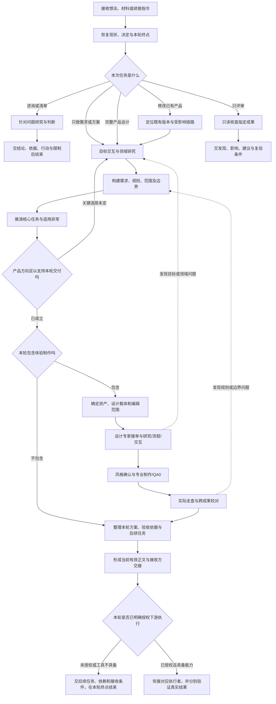

# 融合产品锤 0.3.2：完整工作流程与人机输入输出

版本基准：2026-11-02产品优先路由版本。产品部分沿用融合0.2.0，并明确产品负责人先形成用户、场景、目标和范围；设计部分由同事设计模块接管。本文是规则说明，不代表真实效果已经验证。

## 0. 阅读前提与依据

本文描述的是当前包**要求Agent怎样工作**。它不等于这些行为已经被业务实测证明，也不等于平台已经实现了自动研发、上线和变现。

为方便阅读，本文将原有非固定主线展开为多个环节；编号仅用于定位，不是新的阶段体系。各环节可以合并、交叉、回退；列出的产物是应包含的内容，可以放在同一份当前正文中，不要求逐个生成文件。示例问题与产物字段是解释性展开，不声称是现有脚本强制执行的表单。

主要依据：

- [主入口及整体运行规则](../package/skills/fusion-product-agent/SKILL.md)
- [工作合同与任务终点](../package/skills/fusion-product-agent/references/work-contract.md)
- [领域构建与价值路径](../package/skills/fusion-product-agent/references/domain-and-value.md)
- [提问、决定与状态恢复](../package/skills/fusion-product-agent/references/dialogue-and-state.md)
- [产品规则与路径方法](../package/skills/fusion-product-agent/references/product-method.md)
- [设计与Demo](../package/skills/fusion-product-agent/references/design-and-demo.md)、[Figma适配](../package/skills/fusion-product-agent/references/figma-adapter.md)
- [复杂对象与异常](../package/skills/fusion-product-agent/references/complex-systems.md)
- [评审与交接](../package/skills/fusion-product-agent/references/review-and-handoff.md)
- [产品正文模板](../package/skills/fusion-product-agent/assets/product-definition.md)、[设计输入模板](../package/skills/fusion-product-agent/assets/design-task.md)、[交接模板](../package/skills/fusion-product-agent/assets/handoff.md)
- [当前验证范围](../package/VALIDATION.md)

## 1. 谁负责什么

### 1.1 使用者默认是什么状态

使用者可以只有业务想法、抱怨、任务、老板的一段话、聊天记录、表格、截图或现有系统入口；可以不了解产品方法、行业术语、完整业务规则和异常路径，也可以明确说“不知道”。没有要求其先提交完整PRD、流程图、功能清单或行业知识报告。

使用者通常能贡献四类信息，但不是启动时一次填完：

1. **想法与目标**：为什么想做、希望改变什么、谁的任务受阻。
2. **现场事实及可取得的原件**：实际由谁操作、现在怎么做、某次真实输入与结果、合同/单据/截图/系统记录在哪里。
3. **现实约束**：时间、已有系统、必须保留的行为与资产、组织责任、交付载体等已知条件。
4. **有权决定的取舍或委托**：优先解决谁的问题、本期范围、几条方案间的选择、哪些普通设计选择委托锤子推荐处理。

这些信息如果已经存在于聊天、材料或系统中，锤子先恢复，不重复索取。使用者不知道某项组织事实时，锤子应指出能从什么材料或验证任务取得。

### 1.2 锤子默认承担什么

锤子承担：理解不完整输入、检查错误前提、主动发现领域知识缺口、自行研究、构建需求与规则、界定边界、比较方案、构建体验、覆盖异常、维护当前版本、校验一致性、形成验收及上下游交接，并说明如何继续验证采用和收益。

“没有专家”会增加锤子的研究责任。它不会授予访问企业系统、伪造外部事实、代表企业批准经营规则或操作生产的权限。

### 1.3 人机输入不是同一件事

后文的“输入”包含三种来源：使用者给的原始信息；锤子自行检索/读取的证据；上一步产生的模型与产物。不能把全部输入清单理解成使用者的必填表。

## 2. 总体主线

任何时点出现关键缺口，都进入“分类取证/决定”的处理，不强制推倒全流程；问题只影响局部时，独立工作继续。

## 3. 不同入口场景的流程与交付边界

| 使用者表达/场景 | 必需输入从哪里来 | 锤子主要工作 | 默认输出 | 什么情况下需要使用者动作 |
| --- | --- | --- | --- | --- |
| “我有个Idea，想帮我看看” | 一段想法、想改善的任务及上下文；没有专业方案也可启动 | 先判断是在探讨方向还是要求完整设计；给目标、领域草图、价值路径与关键未知，再逐步澄清 | 探索性判断或按明确范围进入后续设计；不会仅因提到Idea就承诺完整系统 | 目标有不同解释、范围会实质改变时，讨论具体目标和希望做到的成果 |
| “分析一下/这个能不能做/给一份清单” | 指定问题、已有材料和约束 | 针对性研究、前提检查、方案比较 | 结论、依据、适用条件、可行动清单、待取证事项 | 必需现场事实或关键取舍无法从材料得出时；不要求为咨询选择视觉风格 |
| “只梳理需求/只做方案” | 目标、现场材料、已有规则；专业知识由锤子补齐 | 领域研究、需求/边界、核心流程与取舍 | 指定范围的需求/规则方案、待决、验证与后续任务 | 目标、范围或组织经营选择确实未定时；不自动做Demo |
| “完整产品设计/一直到开发前” | 可从Idea及原始材料开始，缺口逐步补齐 | 执行完整产品主线，按风险深度展开 | 当前产品正文、必要设计依据、可操作且有样式Demo、验收/依赖、交接 | 目标与关键经营选择、必要材料或访问、关键体验反馈；不逐阶段回复“继续” |
| “改一下已有功能/完善已有Demo” | 当前版本/入口、变更目标、现状材料与保护范围 | 找影响链，增量改规则/设计/Demo，核查共享影响 | 受影响成果的新有效版本、差异、验证与续做说明 | 找不到现状、修改会触及保护范围、需要新业务取舍时 |
| “只评审” | 评审对象、版本、用途和范围 | 只读核查规则、设计、Demo或交接 | 具体问题、证据、影响、建议及复验条件 | 必需上下文缺失时请求证据；不直接修原件 |
| “继续” | 既有状态、成果、决定和委托 | 从未完成位置恢复 | 接续产物或本轮完成结果 | 无法定位关键决定、出现新的未委托高影响取舍时 |
| “帮我上线/从想法做到变现” | 已有产品成果、实际任务范围、工具与系统权限、真实环境和商业材料 | 先识别产品锤可完成部分及下游执行条件 | 产品与交接输入、对应下游任务和价值验证路径；真实执行结果另行举证 | 需要真实系统访问、部署/外发/扣费授权或经营决策时；仅一句目标不证明平台已有全部执行能力 |

任务路由由锤子判断；使用者不需要理解内部模式名。入口表达有歧义时，只问会改变本次工作范围的差异。

## 4. 环节一：接收输入、恢复上下文与本轮终点

### 输入

- 使用者本轮原话，保留其中的明确要求、限制、委托及原始表达。
- 当前项目资料、历史聊天中的有效决定、当前产品正文、设计/Demo入口、未完成事项。
- 已有资产、受保护范围、环境工具、指定载体和实际访问能力。

### 锤子处理

先判断是新任务还是续做，是咨询、方案、完整设计、局部改动还是只评审。检查有没有把功能当目标、把愿望当现状、把某人意见当批准、把“接口文档存在”当生产已通等前提跳跃。

恢复本轮要解决什么、交给谁、做到哪里算完成；已有明确答案直接沿用。若只要求一个局部结果，不擅自扩为全系统。

### 输出

一个足够明确的本轮工作约定：当前问题、目标使用者、范围、保留项、约定成果、终点、已有证据、关键未知。可先放在对话或已有正文中，不必生成独立合同文件。

### 使用者什么时候要做什么

已有终点明确时，不需要再批准一次。若“做个原型”可能表示静态图、交互稿或可操作Demo，且差异实质影响成果，则用业务语言让使用者明确用途。若无法定位旧项目，让使用者提供旧成果入口或必要文件，而不是重讲全部历史。

### 可继续与等待条件

未知不会改变当前方向时先推进；若连要解决谁的问题、授权做什么都存在根本歧义，则先给出初步理解和推荐，等待该关键点澄清后再做依赖它的部分。

## 5. 环节二：围绕想法与业务目标交互

### 输入

原始Idea、任务痛点、真实案例、已有系统路径，以及使用者希望发生的变化。

### 锤子处理

把想法展开成：谁在什么情境完成什么任务，现在障碍是什么，造成什么后果，希望结果怎样改变。区分使用者、受益方、采用决定方和付款方；不是每个任务都需要新建系统或新增收费。

形成初步方案方向、领域草图、价值路径与关键未知，并用具体故事核对理解。锤子可以指出目标冲突，例如希望减少人工判断，又希望所有异常都由人工逐单审批；应解释冲突并给取舍。

### 输出

- 当前问题与目标的业务描述。
- 核心角色及任务，已有证据与待验证目标假设。
- 初步方向及备选、推荐理由、影响方向的未知。
- 哪些变化算有价值的初步判断；没有数据时不编造量化收益。

### 使用者动作

主要是补充想法、校准目标、描述实际受阻案例、作业务优先级取舍。比如：“你更希望先解决处理慢，还是结果对不上？如果两者都重要，哪一个是本期不能接受的问题？”

使用者不用先画完整流程、罗列专业异常或定义数据库对象。只会说“我觉得很麻烦”也可作为起点，由锤子追到具体任务。

### 回退条件

后续研究或代表体验发现目标理解错了，回到本环节校准，再检查受影响需求；不以已经做了页面为由坚持错误方向。

## 6. 环节三：主动研究领域并补出隐含需求

### 输入

目标与任务、适用业务环境、已有原始材料、已知术语、目前的知识缺口、可访问的一手来源与系统。

### 锤子处理

先分清：可查专业知识、组织现场事实、经营选择、外部能力未知。为当前目标制定研究问题，不要求先研究完整行业。

研究对象包括：领域概念、业务对象及关联、生命周期、参与方职责、约束、权威数据来源、正常/反向/失败路径，以及上下游需要哪些凭据或结果。具体研究范围取决于真实任务，不把同一个功能模板套到所有业务。

对外部来源核对发布者、时效、适用范围和原文；高影响/易变事实按环境要求核实当前一手信息。对企业自身事实，优先看实际原件和记录，不能拿行业惯例当成本企业制度。

主动识别“使用者没说但目标成立必须具备”的需求。每项说明依据、必要性及影响；可选增强与必需需求区分。

### 输出

- 领域草图：术语、对象、关系、状态、职责及权威数据。
- 与任务相关的来源和适用判断。
- 锤子主动补出的隐含必需需求，及其与目标的关系。
- 有证据事实、候选假设、缺失组织事实、阻断动作的关键未知。
- 具体下一取证或验证动作。

这些内容要继续转成产品规则、流程与验收。仅附资料链接或一篇研究总结，不算需求构建完成。

### 使用者动作

专业知识可以查证时，锤子自行研究。需要企业内部原件时，使用者提供可取得的合同/单据/截图/记录或访问入口，不要求其自行解释专业制度。

若使用者说“不知道现在是哪个系统记的”，锤子应提出取得证据的具体方法，例如查看现有导出、某笔记录的来源字段、实际操作结果；仍取不到则明确受影响结论。

### 可继续与等待条件

来源不足时不能假装已核实。可逆方案假设可标明条件继续设计；会决定高风险动作合法性、责任或结果正确性的未知，保留该动作受阻。其他独立模块继续。

## 7. 环节四：形成方案取舍、本期范围与价值路径

### 输入

目标、领域模型、隐含需求、现有能力证据、实际约束及已确认的经营决定。

### 锤子处理

比较改变现有流程、扩展已有系统、新建能力等适用方案，说明解决什么、成立前提、依赖和代价。把目标必需事项与可选优化分开，形成有依据的推荐。

说明当前产品如何交付、如何开始使用、由谁决定采用，以及怎样验证任务价值。收益只能是有依据的事实或明确待验假设。

### 输出

当前推荐方案、适用边界、本期核心任务、明确排除项、保留资产/行为、依赖、价值路径和下一验证任务。

### 使用者动作

需要人作的是有权决定的经营取舍：本期优先服务谁、业务上允许哪类行为、愿意接受何种体验/责任代价、本次做到何处。锤子先给推荐和具体后果，不能只给一串抽象选项。

普通可逆设计选择若已委托，直接处理并记录必要依据。人的批准只能决定期待的业务行为，不能证明法律适用、接口存在或市场愿意付款。

## 8. 环节五：构建对象、规则、职责与系统边界

### 输入

领域依据、选定方案、核心任务、本期范围、组织事实、外部系统或能力证据。

### 锤子处理

把业务讲成可执行模型：角色/职责 → 对象及归属 → 对象关联 → 合法状态与转换 → 允许动作 → 约束/结果 → 异常与恢复。

每项核心规则说清：适用谁、何时触发、作用哪个对象、需要什么条件、改变什么、给谁看什么、失败后谁负责。

对每条关键边界明确：上游在什么前提下给什么；本环节处理什么；下游接收什么；什么算接收成功；拒收/失败回到哪里。说明权威数据在哪里，避免两个系统各自声称最终正确。

出现资金、权益、权限变化、异步、并发或不可逆动作时，深挖请求、正式业务对象、外部结果和展示状态的区别。超时与明确失败分开；产品可以要求防重和恢复，但具体技术能力需证据，不能凭前端按钮保证。

### 输出

角色职责、对象关系、状态及转换、可追溯核心规则、输入输出/责任边界、适用异常和外部能力缺口。可以是表格、流程或当前正文，不要求固定建模工具。

### 使用者动作

只在企业实际责任、权限政策、业务允许范围等无法从证据确定且未被委托时，请有权决定者判断。若所问的是对象、状态、幂等或异常模型等专业构建工作，应由锤子先完成。

例如，应围绕“某种业务行为是否允许、出问题由谁负责”讨论，而不是要求非专家选择某种后端技术方案。

### 进入后续的条件

核心对象和高风险规则应在制作相关操作前足够清楚。不要求全系统每个低风险细节都定稿；关键未知不能藏到页面里默认处理。

## 9. 环节六：推演任务路径、入口与适用状态

### 输入

角色、对象、规则、职责边界、真实使用端及核心任务。

### 锤子处理

从首次使用或真实起点开始，不假设账号、数据、基础配置天然存在。逐条描述：谁从哪进入、前置是什么、看到什么、做什么、系统如何变、反馈什么、怎样结束、失败或退出后怎样继续。

按适用范围覆盖空数据、非法/过期输入、慢网、失败、结果未知、部分成功、重复操作、权限变化、并发、异步、退出和恢复。不会为凑状态增加无关功能。

将任务映射到入口、页面职责、信息层级与动作，先核对用户能否找到和理解下一步。

### 输出

端到端核心任务路径、首次使用路径、页面/入口职责、适用状态目录、关键文案含义，以及初步的前置—操作—预期验收场景。

### 使用者动作

锤子可给一段完整业务故事，请使用者确认是否符合实际目标和现场，例如“这一步结束后，下一岗位是否真的能开始工作”。这属于事实与体验校准；不是要求使用者自行发现所有异常。

若本轮只做方案，完成适用的规则、路径、待决及后续任务后可到约定终点，不强行进入体验制作。

## 10. 环节七：产品交给设计专家

产品提供当前正文及准确版本、业务目标、领域依据、规则/对象、范围、场景/状态与业务验收预期；同时交已有设计、素材、风格决定、文件/节点、工具和编辑/保护范围。骨架与交互提案供设计专家质疑，不锁死控件与布局。详细字段见[设计任务](../package/skills/fusion-product-agent/assets/design-task.md)。

读取[设计专家主入口](../package/skills/fusion-design-core/SKILL.md)，由它判断0到1、已有需求优化、存量延展或按正式稿还原的切入点。旧融合设计步骤不再执行。

## 11. 环节八：专业设计推导与风格确认

设计专家按自身方法处理研究/竞品、信息架构、页面职责、流程与具体交互。0到1按其主入口先汇报前置推导，再通过原生提问确认风格、适用头像画风和交互/交付载体；到其停止点等待回应，不先写稿后补确认。已有正式规范及存量延展按对应分流处理，不无故重选。

用户看到具体建议后作选择；产品主线接回影响业务规则或已确认范围的冲突，维护唯一正文。已存在的证据和决定提供给设计专家判断复用，不成为绕过其明确确认要求的理由。

## 12. 环节九：组件、素材与设计制作

设计专家负责组件/主题/字体、真实素材、页面与状态要求及专业提示词。实际制作前按同包[Figma执行工作流](../package/skills/fusion-figma-workflow/SKILL.md)初始化、复用配置与绑定目标。已有本产品Figma主稿或已选Figma时，旧页Computer Use精修，新增整页按需Agent生成后精修；设计核验后读取同版Dev Mode / MCP上下文、截图和原始素材还原Demo。

工具和账号先按[接入](../package/skills/fusion-product-agent/references/figma-adapter.md)核对，用户指定载体、文件与保护范围仍须遵守。不擅自新建Figma项目，不把未配置服务写成已调用。缺失Figma执行条件先引导恢复；未经明确选择，不以本地制作替代已选Figma。初始化、任务包、执行前核对卡、实际画布证据与Demo文案/交互复核随包提供，既有有效决定不重复确认。

## 13. 环节十：设计终审与产品核对

设计专家执行QA0的可用性、审美与品位、设计标准与工程规范三维终审，结合实际脚本、成品看图、对照及主路径/失败分支操作，失败回到对应设计环节。辅助UI/UX Pro Max和Impeccable按需服务它，不并行跑另一套主流程。

回传设计决策、成品与版本/节点、页面/状态对应、组件/素材来源、QA0结论、真实检查证据、差异和未覆盖。产品主线核对业务目标、领域规则、场景覆盖、版本与交接条件，不重新套旧视觉标准。自动脚本PASS、设计判断通过、业务正确、用户确认和生产验证分别报告。完整接口见[产品到设计交接](../package/skills/fusion-product-agent/references/design-and-demo.md)。

## 14. 环节十一：收敛当前产品正文与正式交接

### 输入

从前面逐渐形成的目标、领域依据、范围、对象规则、边界、核心路径、设计/Demo、验收、有效决定及检查结果。

### 锤子处理

持续维护一处当前规则正文，正式交接前收敛有效版本和完整内容；不是等Demo做完才第一次写PRD。设计、研发、QA阅读材料由同一规则来源裁剪，不各自维护另一份可独立改动的规则。

让首次接收者先看到当前结论和入口，再下钻依据与历史。必要时使用稳定规则引用和关键快照，版本号可不同，但具体覆盖必须说清。

### 当前产品正文应覆盖的内容

| 内容 | 应回答的问题 |
| --- | --- |
| 问题、用户及终点 | 为什么做，服务谁，本轮做到哪 |
| 现状与依据 | 目前真实怎样，哪些决定有效，材料在哪里 |
| 领域依据与必需需求 | 锤子补齐了什么，来源适用吗，有哪些隐含必需事项 |
| 方案与取舍 | 为什么采用这个方案，替代方案及条件是什么 |
| 对象、规则和边界 | 谁对哪个对象做什么，上下游怎样接收，失败怎样回来 |
| 任务路径 | 入口、前置、动作、反馈、结果及恢复是什么 |
| 设计与Demo | 从哪打开，覆盖哪些规则/状态，与正文有何差异 |
| 验收与依赖 | 做什么、看什么结果，哪些不允许，哪些真实条件尚未验证 |
| 价值路径 | 怎样交付/采用，付费或收益假设怎么验证 |
| 交接和续做 | 下一环节收到什么，要完成什么，怎样回传结果 |

### 按接收方交接

| 接收者 | 输入给他的内容 | 要让他完成的下一任务 | 可判定接住的输出 |
| --- | --- | --- | --- |
| 业务负责人 | 目标、当前方案、体验入口、取舍和待决 | 判断是否符合目标并作必要业务决定 | 具体反馈/决定及范围，而不只是“看过” |
| 设计接收者 | 规则、页面/状态、主稿/素材、保护范围 | 在规则内制作或继续精修 | 可定位设计成果、状态对应、差异及未覆盖 |
| 研发接收者 | 对象、字段、规则、状态、权限、异常、接口证据/缺口、Demo与验收 | 继续技术判断、拆解或已授权实现 | 事先约定的技术判断/拆解/实现结果；具体依本轮接收任务 |
| QA接收者 | 规则与场景、前置数据、操作、预期、不允许结果及未验证 | 构造或执行相应验收任务 | 用例/执行证据/问题及覆盖；生成用例与实际运行分开 |
| 运营/交付接收者 | 适用对象、前提配置、使用入口、异常处理和价值验证任务 | 组织首批使用或相应交付 | 实际采用/交付记录、问题和价值证据，前提是任务已明确分派 |
| 后续维护者 | 当前版本组合、决定、变更、未完成和恢复条件 | 不重做历史即可继续 | 对应续做成果及受影响验证结果 |

这里定义交接内容，不代表当前包已内置这些执行角色，也不代表材料已实际外发。

### 使用者动作

指定真正接收者或提供其可用入口；若未安排真实接收，则交本地包并标“已准备、未外发”。需要评估真实接手能力时，安排未参与的人完成一项具体下游任务，记录其结果、追问和重构点。

## 15. 环节十二：本轮完成、下游实施及价值验证

### 输入

约定成果、必要决定/明确委托、实际检查、剩余依赖及下游任务。

### 锤子处理与输出

分别说明：

1. **文件已准备**：本地材料存在可读。
2. **指定版本已收到**：有实际接收证据。
3. **接收方能据此继续**：完成了约定下一任务。
4. **本轮产品范围已完成**：必需成果与决定具备，关键阻断已处理，剩余验证明确。
5. **真实实施/生产验证通过**：有相应环境与任务结果。
6. **采用、付费或经营收益成立**：有对应真实证据，不由前几项自动推得。

若本轮到开发前，就在这里结束产品执行，交研发、上线、采用和收益验证所需任务与接收条件。不能因为产品材料里写了“上线方案”就宣称已上线。

### 使用者动作

后续确实要实施时，需要明确相应范围，提供真实资源/权限，安排有权限的执行者。部署、外发、扣费等动作遵守已有授权；没有必要的授权与能力就不能自动执行。

到了真实业务验收，让目标用户执行任务并核对结果。“很专业”“愿意用”“实际使用”“愿意付款”“已经付款”“产生经营收益”分别记录。

### 当前包的实际边界

当前包已定义领域研究、产品构建、体验和交接的执行规则，包含本地辅助校验脚本；没有随包内置自动部署、企业系统连接、交易收款、客户运营或收入归因机制。本轮也没有按新口径完成真实业务实测。因此，全链路后半段目前应描述为要构建和衔接的任务，不能写成已证明的自动能力。

## 16. 穿插场景：什么时候要求使用者做什么

### 16.1 决定是否找人的顺序

先查已有来源、决定与授权 → 判断缺口类型 → 自行研究或核实 → 判断是否有有效委托 → 再请求真正需要人的动作。与目标相关的创意交互可持续进行，但不把每次展示当成必须等待的审批。

| 触发场景 | 锤子先做什么 | 请求使用者什么 | 没有回应/做不到时怎么办 |
| --- | --- | --- | --- |
| 目标含糊或互相冲突 | 用业务故事复述、给解释和推荐 | 校准目标或优先级 | 候选解释可先研究；依赖根本方向的制作不擅定 |
| 缺领域专业知识 | 查适用一手来源并转成规则/案例 | 通常不要求回答专业问题；只需无法取得的入口/原件 | 无法核实时说明范围、替代路径和验证任务 |
| 缺企业现场事实 | 先查材料和记录，定位具体证据 | 提供脱敏原件、样例、实际操作结果或访问 | 建候选与取证任务，关键动作受阻，独立模块继续 |
| 有未决定的经营选择 | 提供推荐、前提和后果，检查委托 | 有权决定的人作取舍或明确委托 | 不把沉默算批准；保留受影响候选 |
| 普通可逆细节已获委托 | 自行选择并落实 | 无需逐项操作 | 继续工作，不增加“继续”回合 |
| 需要登录/工具权限 | 核对真实缺什么能力 | 在相应界面登录、授予必要访问或提供替代材料 | 继续独立工作，相关制作/验证保持未完成 |
| 指定载体或路线不可用 | 尝试合理恢复，说明交付影响和备选 | 必须改变要求时作选择，已有明确例外则沿用 | 不私自更换后宣称满足原要求 |
| 编辑目标/保护范围不清 | 恢复现有位置、决定和可回退依据 | 明确允许编辑位置与必须保护内容 | 不改不明确的目标，继续准备不依赖写入的工作 |
| 关键体验需要校准 | 制作可看/可用代表成果，说明判断点 | 体验并反馈是否完成目标和是否贴合现场 | 已委托部分继续；尚未决定的关键选择不默认通过 |
| 高影响事实冲突 | 核查时间、范围、来源效力和原始材料 | 仅在组织事实/有权取舍需人时请求原件或决定 | 受影响规则待定，避免用最新文件一概覆盖 |
| 需要真实用户/真机验证 | 准备场景、前置、操作与预期 | 安排目标岗位、设备或现场任务 | 报未验证，不冒充通过 |
| 真实下游交接 | 先形成可读完整包与接收任务 | 指定接收者；需要实际发送时具备授权 | 仅标已准备；不能写对方已收到或已接住 |
| 新增范围、外发、部署或真实扣费 | 查是否已有相应明确授权，准备可审阅内容 | 缺必要授权时明确要求相应决定 | 不能从普通设计委托推成外部执行许可 |
| 后续收益证据不足 | 定义可观察价值和取证任务 | 在可授权范围提供真实采用/付费/经营结果 | 保留价值假设，不能编造收益 |

### 16.2 一次向人提出问题应包含什么

先说当前具体情境，再说要决定/提供什么、锤子的推荐或已查结果、不同选择的实际后果，以及会影响哪个任务。能用一份真实材料解决的问题，不要求使用者先写总结；同路径问题合并，不把整个项目问卷一次发出。

### 16.3 人说“不知道”时

锤子先判断不知道的是专业知识、现场事实还是经营选择。专业知识继续研究；现场事实寻找原件与取证路径；经营选择提供具体情境、推荐和后果帮助决定。不能把“用户不知道”一律记为等待专家，也不能替人捏造未知事实。

### 16.4 人说“全部按你推荐”时

在明确任务与决策范围内作为有效委托，记录并继续；不重复要求每一步批准。设计专家主入口明确要求的风格选择和停止点仍按其规则处理，不由产品主线擅自免除。它不会证明外部能力，也不会自动包含未约定的生产操作、外发、真实扣费或跨组织责任批准。

## 17. 穿插场景：变更、暂停、恢复与局部阻断

### 17.1 使用者中途改目标或规则

**输入**：新要求/新证据、原有效规则、设计/Demo、验收和范围。

**处理**：区分明确改动与间接推导；保存必要旧快照；判断影响哪些对象、流程、页面、文案、Demo和验收；更新当前有效正文，再改受影响派生成果，复验共享影响。

**输出**：变更内容和来源、受影响范围、当前有效版本组合、更新成果、复验和仍未同步部分。

**人的动作**：明确修改本身不再次确认；若由它产生额外未委托的高影响取舍或超出原范围，再说明后果并请求决定。规则超前于Demo时列明差异，不把说明差异当作行为已通过。

### 17.2 暂停后续做

**输入**：当前状态、成果入口、决定/委托、未完成、验证覆盖及恢复条件。

**处理**：从已有工作恢复，不重访谈、不静默重建；核对较新的明确消息，避免旧状态覆盖新决定。

**输出**：接续成果、更新的有效状态和下一步。

**人的动作**：通常只需“继续”；关键决定来源无法定位时补必要原件或审阅，不重讲所有历史。“继续”承接已授权工作，不自动批准尚未决定的新取舍。

### 17.3 某一环节或模块被阻断

**输入**：具体缺口、已查证据、影响链、独立工作清单。

**处理**：将问题定位到受影响动作；提出取证/替代/恢复条件；继续不依赖它的工作。

**输出**：受阻范围、已完成部分、剩余任务、解除条件和实际验证边界。

**人的动作**：只有其掌握材料、权限、经营决定或现实资源时才请求具体动作。全部关键路径均依赖该未知时，明确无法完成本轮终点，不通过缩范围冒称完成。

### 17.4 工具故障或运行能力不足

**输入**：实际错误、工具可用性、指定路线及不依赖工具的工作。

**处理**：合理恢复；不能完成的明确列出；可继续规则/路径研究、设计任务准备等独立工作。

**输出**：真实完成内容、待制作/待验证内容、具体恢复条件。

**人的动作**：需人登录、提供权限或接受改变交付条件时才请求。仅有代码不写体验已验，静态截图不写可操作，无法读取设计结构不声称准确还原。

## 18. 一个贯穿流程的使用示例

以下仅说明工作方法，不是财务制度或税务处理建议。

**起点**：使用者说：“月底各业务给我的数据总对不上，我想做个工具，但我不懂财务系统。”

| 过程 | 输入 | 锤子输出 | 人做什么 |
| --- | --- | --- | --- |
| 理解目标 | 原话和现有材料 | 区分数据收集慢、匹配困难、差异无法解释等候选问题，给初步理解 | 讲一次具体受阻经历，校准主要目标 |
| 查领域与现场 | 目标、可取得的原表/记录、来源权限 | 任务相关的对象关系、权威来源候选、状态、隐含需求和缺口 | 提供可取得的脱敏表/截图；不知道专业概念可以直接说 |
| 形成范围和方案 | 研究结果、约束 | 推荐首期覆盖任务、明确不做、依赖和价值验证路径 | 选择业务优先级；普通方案细节可委托推荐 |
| 构建规则边界 | 对象、组织事实、证据 | 哪个输入来自哪里、由谁确认结果、差异怎样处理、下游接什么 | 只核对实际责任或有权决定的经营政策 |
| 体验代表路径 | 规则、典型样例 | 可连续操作的代表Demo和关键异常 | 看是否贴合真实任务，指出事实偏差 |
| 模块展开与检查 | 代表反馈、全部约定任务 | 完整Demo、规则/设计/验收一致性、检查证据 | 需要真实账户/现场任务时安排资源 |
| 产品交接 | 当前有效正文、体验、验收 | 可供研发/QA接手的输入、样例、结果要求及依赖 | 安排真实接收者，按约定任务验证能否接手 |
| 真实验证 | 授权实施后的系统、未展示过的真实案例 | 对应任务实际结果、问题与覆盖；不是产品包自己假定的结果 | 真实目标岗位完成任务并核对结果 |
| 价值验证 | 真实使用与经营记录 | 是否采用、是否达到约定价值及缺失证据 | 提供实际记录或安排后续取证 |

整个过程中，使用者不需要先成为财务产品专家；但锤子也无法凭空知道该企业哪张表才是权威事实，仍需原始材料和现实验证。

## 19. 当前仍未细化或尚未实证的部分

为避免把本文的细致描述误当作新增平台能力，下列边界需要保留：

1. **领域知识获取是工作方法，尚无随包行业连接器或已验证的领域知识库。** 当前包要求研究一手来源、适用范围与案例；具体能取到什么取决于宿主工具与授权。
2. **领域完整性没有统一量化阈值。** 规则要求主动发现必需需求和异常，用案例与真实结果检验；没有一个脚本能证明“本行业知识已全部补齐”。
3. **产品环节不逐级签字。** 设计部分按设计专家的明确步骤和风格确认要求执行；本文编号本身不增加额外审批。
4. **详细输入输出可合并为现有正文。** 本文展开的清单不是已实现的自动表单/自动状态机，也不要求生成相同数量的文件。
5. **产品与行业判断需要分开。** 七类48项定义覆盖产品本体能力，不是财务、酒店等行业专业正确性的认证。
6. **上下游交接方法已经定义，自动编排尚未证明。** 当前包不保证自动找到接收者、替人授权或自动运行所有执行角色。
7. **从想法到变现后半段尚需具体执行能力和任务合同。** 上线、运营、真实交易与收益验证不因交接文件齐备而成立。
8. **本版完成结构及离线脚本检查，尚未完成设计替换后的真实业务试验。** 本文说明应如何执行，真实能力需看任务、接收与用户结果。
